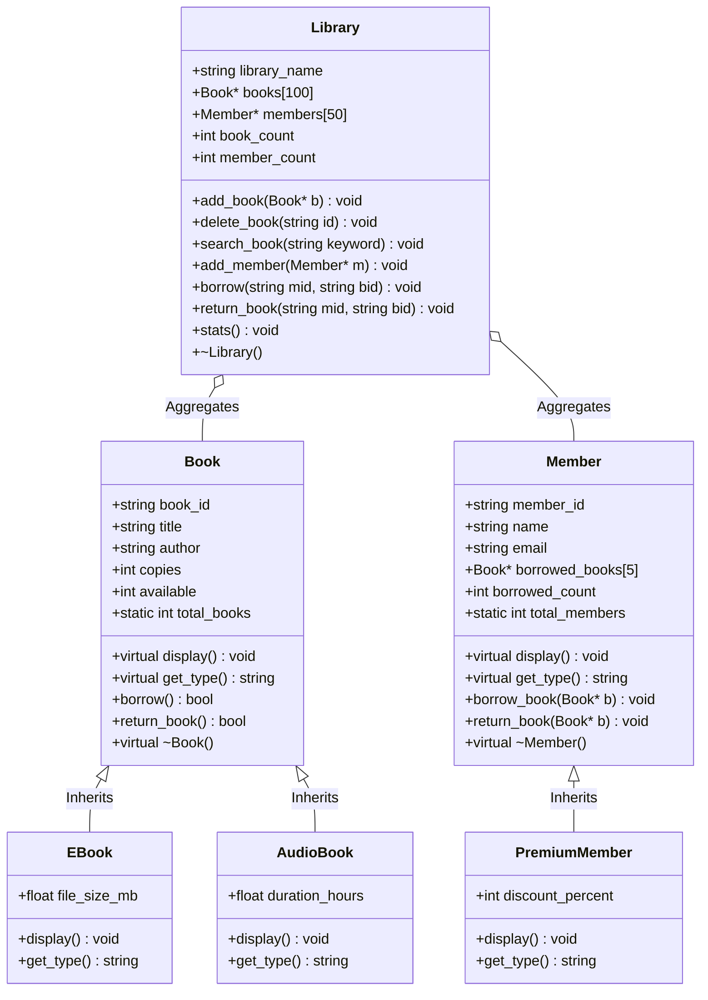

# 📚 Object-Oriented Library Management System in C++

[](#)
[](#)
[](#)
[](#)
[](#)
[](LICENSE)

> A modular, console-based Library Management System engineered in modern C++ demonstrating the core pillars of Object-Oriented Programming (OOP): Inheritance, Runtime Polymorphism, Dynamic Dispatch, Encapsulation, and Heap Lifecycle Management.

---

## 🏛️ Object-Oriented Architecture & Class Hierarchy



---

## 🌟 Core OOP Concepts Implemented

1. **Inheritance & Specialization:** Base entity `Book` is extended into specialized media types `EBook` (with digital file size attributes) and `AudioBook` (with listening duration). Similarly, `Member` is specialized into `PremiumMember` with membership perks.
2. **Runtime Polymorphism & Virtual Functions:** Methods `display()` and `get_type()` are declared `virtual`, enabling late binding via virtual method tables (vtable) when iterating through heterogeneous object arrays (`Book*[]` and `Member*[]`).
3. **Encapsulation & Data Invariant Protection:** Critical counters (`total_books`, `total_members`) and borrowing thresholds are protected against illegal state transitions.
4. **Dynamic Memory Safety:** Custom destructor `~Library()` traverses object arrays to explicitly deallocate allocated heap memory, preventing memory leaks.
5. **Role-Based Authentication:** Protected administrative portal requiring pin credentials before permitting catalog modification.

---

## 🖥️ Interactive Console Workflow

```text
  ================================
     LIBRARY MANAGEMENT SYSTEM   
  ================================
         ADMIN SIGN IN           
  ================================
  Enter Password: ****
  Access Granted! Welcome Admin

  ================================
     LIBRARY MANAGEMENT SYSTEM   
  ================================
  [1] Book Management (Normal, EBook, AudioBook)
  [2] Member Management (Standard & Premium)
  [3] Borrow / Return Operations
  [4] Real-time Library Telemetry & Stats
  [0] Exit System
```

---

## 🛠️ Build & Run

### Prerequisites
Any standard C++ compiler supporting C++11 or newer (`g++`, `clang++`, or MSVC).

```bash
# Clone the repository
git clone https://github.com/arslantariq364/Library-Maanagement-System-OOP-Project.git
cd Library-Maanagement-System-OOP-Project

# Compile with optimization and compiler warnings
g++ -std=c++17 -Wall -Wextra -O2 Library_Management_System.cpp -o library_system

# Execute
./library_system
```

> **Default Admin Credential:** `1234`

---

## 👨‍💻 Author

**Arslan Tariq**  
*Computer Science Undergraduate @ FAST NUCES*  
*Applied Physics Teaching Assistant*  
[GitHub Profile](https://github.com/arslantariq364)

---

## 📜 License

Distributed under the MIT License. See [LICENSE](LICENSE) for details.
